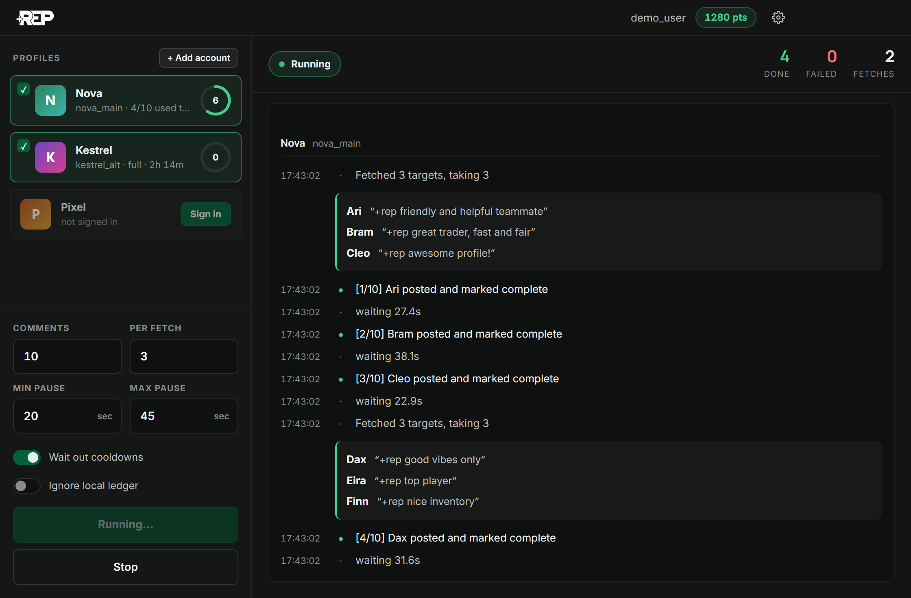
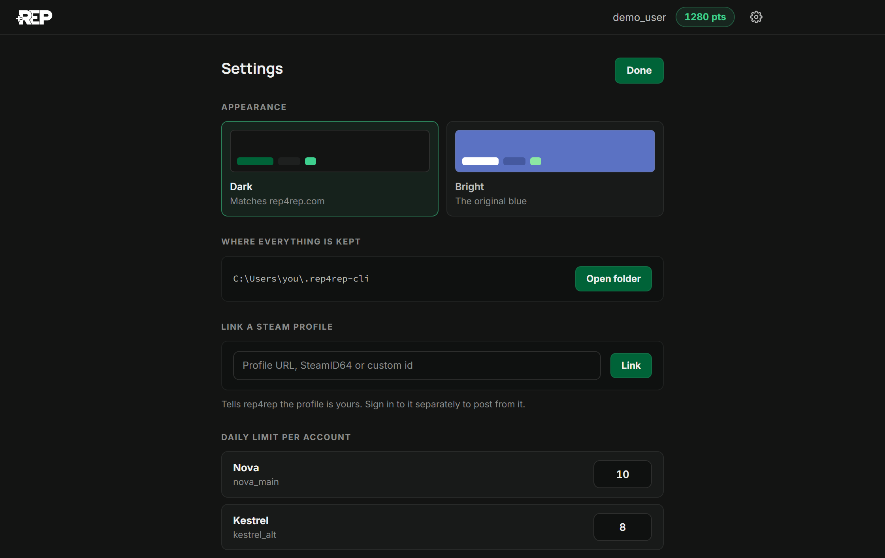
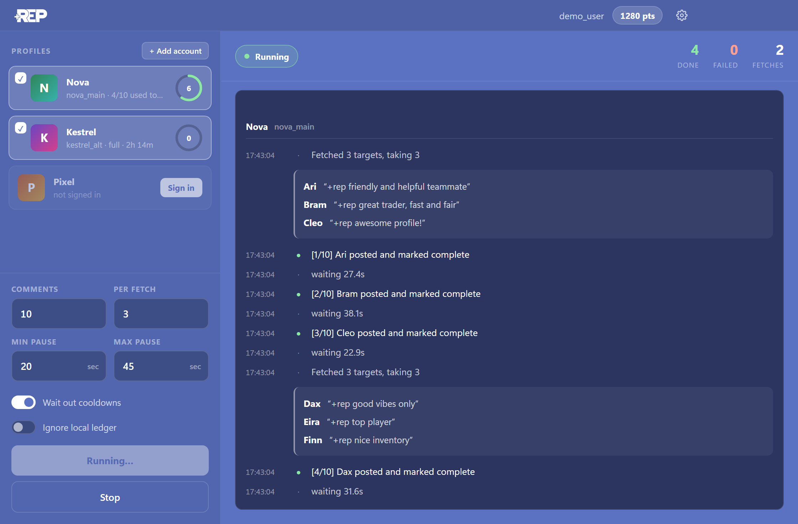

<div align="center">

# Rep4Rep

**Earn [Rep4Rep](https://rep4rep.com) points without the copy-paste.**
A small Windows app that picks up your comment tasks, posts them on Steam and marks them
complete — at a human pace, within Steam's daily limit.

[](https://github.com/mathisson/rep4rep-bot/releases/latest)

</div>



## What it does

On rep4rep.com, earning points means a loop: open a task, copy the comment, open the
profile, paste, go back, confirm. This app does that loop for you.

- **Runs your Steam accounts in one go.** Pick which signed-in accounts to use and start.
- **Stays inside Steam's limit.** Each account gets about 10 comments a day. The ring on
  every profile card shows what's left and drains as the day is spent.
- **Paces itself.** A random 20–45 second pause between comments, adjustable.
- **Waits instead of failing.** With *Wait out cooldowns* on, it counts down to the next
  free slot and carries on by itself.
- **Shows everything it does.** The feed lists every batch of targets, every comment
  posted and anything Steam refused.

## Getting started

1. **[Download the latest release](https://github.com/mathisson/rep4rep-bot/releases/latest)**
   (`Rep4Rep-win32-x64.zip`), unzip it anywhere and run **`Rep4Rep.exe`**.
   The app isn't code-signed, so Windows may show a SmartScreen warning the first time —
   choose *More info → Run anyway*.
2. **Connect rep4rep.** Paste your API key from rep4rep.com → *Settings → API key*.
3. **Sign in to Steam.** Once per account, including the Steam Guard code if it asks.
4. **Pick your profiles and press *Start run*.**

Your Steam password goes straight to Steam and is never saved — only the sign-in token
Steam hands back. Everything the app keeps stays on your PC, in `%USERPROFILE%\.rep4rep-cli`.

## Settings

The gear in the top-right corner opens settings:

- **Appearance** — *Dark*, matching rep4rep.com (the default), or *Bright*, the original blue.
- **Link a Steam profile** to your rep4rep account.
- **Daily limit per account** — lower it for an account Steam throttles sooner.
- **Stored data** — each file the app keeps, what it's for and what removing it does.

Run settings (comments per run, pauses, toggles) save themselves as you change them.

<p align="center">
  
  
</p>

## Good to know

- **Steam's Subscriber Agreement prohibits automated account activity.** Using this puts
  your Steam accounts at risk of action from Valve. The pauses keep the pace human-like,
  but they're not a guarantee.
- **The daily limit is rolling, not a midnight reset.** Each comment frees its slot again
  exactly 24 hours later.
- **A comment only counts once it lands.** If a target refuses it (private profile,
  comments closed) the task is skipped and another one is fetched in its place.
- If comments start failing, raise the pauses and post fewer per run.

## Run it from source

You need [Node.js](https://nodejs.org) 22 or newer.

```bash
npm install
npm run app
```

`build.cmd` packages the app into `dist\Rep4Rep-win32-x64\Rep4Rep.exe`.

### Command line and daily runs

The same engine also runs from a terminal, without the window. Put your API key in `.env`
(see `.env.example`), then:

```bash
npm start -- login
npm start -- run
```

`npm start -- --help` lists every command and option.

To post automatically once a day, double-click **`schedule.cmd`**. It creates a Windows
scheduled task (09:00 by default; `schedule.cmd 21:30` moves it, `schedule.cmd /remove`
stops it) that uses the sign-ins you've already saved and logs to
`%USERPROFILE%\.rep4rep-cli\daily.log`.

### Tests and releases

```bash
npm test
```

Every push to `main` is tested and packaged by GitHub Actions. Raising `version` in
`package.json` publishes a new release on the next push.
